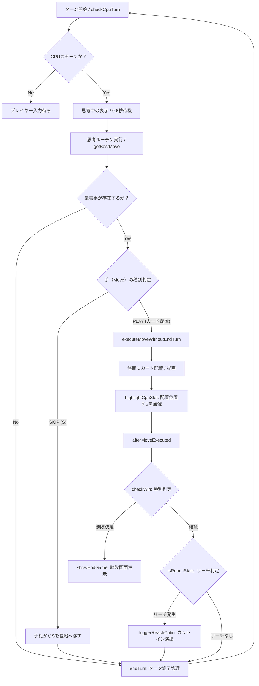

提供された HTML/JavaScript コード（`markslot202410.html`）に基づき、**CPU対戦モードの処理フローチャート**、**使用盤面（DOM要素）**、および **JavaScriptの関数と変数のリスト** を整理して説明します。

---

## 1. CPU対戦モードのフローチャート

CPU対戦モードにおける思考・カード配置・ターン進行の流れは以下の通りです。

---

## 2. 使用盤面（画面レイアウト・DOM構成）

CPU対戦モード中にプレイヤーとCPUが共有・操作する主な画面エリア（DOM要素）です。

| エリア名 | DOM ID / クラス | 説明 |
| --- | --- | --- |
| **ヘッダーコントロール** | `#turn-badge`, `#btn-reset-game` | 現在のターン表示（`P1 TURN` / `CPU TURN`）およびリセットボタン。

 |
| **メッセージバー** | `#message-bar` | ゲームの進行状況やCPUの思考状態（`CPUが思考中...` 等）を表示。

 |
| **場（FIELD）** | `#field-slots` | 全3枠のカード設置エリア。カードの配置・入れ替えや点滅強調演出（`.cpu-highlight`）が行われる。

 |
| **手札（HAND）** | `#hand-slots` | プレイヤーまたはCPUの手札表示エリア。CPUのターン中は裏面（`・`）表示される。

 |
| **公開カウンター** | `#tracker-grid` | 場と墓地に公開されたカードの枚数をカウント表示するエリア。

 |
| **オーバーレイ** | `#overlay` | 決着時に勝利者や引き分けを表示するポップアップ。

 |
| **リーチ演出** | `#reach-cutin` | いずれかのプレイヤーがリーチ状態になった際に表示されるカットイン演出。

 |

---

## 3. JavaScript 関数リスト

### ゲーム進行・UI制御関数

* **`setMode(mode)`**: ゲームモード（2P / CPU / SIM）を切り替え、画面構成を更新する。

* **`initGame()`**: デッキの生成・シャッフル、場の初期セット（2枚配置＋1枠空き）、手札配布、先手後手の決定を行いゲームを開始する。

* **`shuffle(arr)`**: 配列要素をランダムに並び替える（フィッシャー–イェーツのシャッフル）。

* **`drawCard()`**: 山札からカードを1枚引く。

* **`selectHandCard(index)`**: プレイヤーが手札を選択（またはスキップカード`S`を使用）した際の処理。

* **`playToField(slotIndex)`**: 選択中の手札を指定した場のスロットへ配置する。

* **`executeMove(handIndex, slotIndex)`**: カード配置ルールチェック、場の更新、勝敗判定、ターン終了までを一括で実行する。

* **`endTurn()`**: 手札の補充、引き分け判定、ターン交代処理を行い、次のターンの準備をする。

* **`render()`**: 現在のゲーム状態（場、手札、ターン表示、公開カウンターなど）をDOMへ描画・更新する。

* **`setMessage(msg)`**: メッセージバーのテキストを変更する。

* **`showEndGame(title, desc)`**: ゲーム終了時にオーバーレイを表示する。

### CPU対戦・思考アルゴリズム関連関数

* **`checkCpuTurn()`**: CPUのターンであるかを判定し、思考タイマー（0.6秒）をセットする。

* **`getBestMove(pHand, pField, pGraveyard, aiType)`**: CPUの思考エンジン。カウンティングやリーチリスク評価、勝利手の検出を行い、スコアが最も高い手を選択する。

* **`playCpuTurn()`**: 最善手（`getBestMove`の結果）に基づいてCPUのカード配置またはスキップ処理を呼び出す。

* **`executeMoveWithoutEndTurn(handIndex, slotIndex)`**: CPUのカード配置演出用に、ターン終了処理を伴わずにカード配置と描画のみを行う。

* **`highlightCpuSlot(slotIndex, callback)`**: CPUがカードを配置したスロットを3回点滅（`.cpu-highlight`）させてからコールバックを実行する。

* **`afterMoveExecuted()`**: CPUの演出完了後に勝利判定・リーチチェック・ターン交代を行う。

### ゲームルール判定・演出関数

* **`checkWin(targetField)`**: 3枠すべてが埋まり、同じ図柄（または『☆』ワイルドカード）で揃っているか判定する。

* **`isReachState(targetField)`**: あと1手で揃ってしまう危険な「リーチ状態」であるか判定する。

* **`triggerReachCutin()`**: リーチ状態を検知した際に全画面のダイナミックな演出（`reach-cutin`）を発動させる。

---

## 4. JavaScript 変数リスト

### ゲーム状態管理変数（グローバル）

* **`SYMBOLS`** *(Array)*: 基本図柄の定義（`['〇', '×', '△', '□']`）。

* **`TOTAL_COUNTS`** *(Object)*: ゲーム内に存在する全カード枚数の定義（例: 各図柄5枚、☆1枚、S2枚）。

* **`deck`** *(Array)*: 現在の山札（デッキ）に残っているカードの配列。

* **`graveyard`** *(Array)*: 墓地（プレイまたは上書きされて捨てられたカード）の配列。

* **`field`** *(Array)*: 現在の場の状態を表す長さ3の配列（要素はカード文字列または空きを示す `null`）。

* **`hands`** *(Object)*: 各プレイヤーの手札オブジェクト（`{ 1: [...], 2: [...] }`）。

* **`currentPlayer`** *(Number)*: 現在のターンを行っているプレイヤー番号（`1` または `2`）。

* **`selectedHandIndex`** *(Number|null)*: 現在プレイヤーが選択している手札のインデックス。

* **`gameOver`** *(Boolean)*: ゲームが終了したかどうかを示すフラグ。

* **`currentMode`** *(String)*: 現在のモード（`'2p'`, `'cpu'`, `'sim'`）。

* **`cpuPlayer`** *(Number)*: CPUが担当するプレイヤー番号（固定で `2`）。

* **`isCpuThinking`** *(Boolean)*: CPUが思考中・アニメーション中であることを示すフラグ（連打防止用）。

* **`isSimulating`** *(Boolean)*: シミュレーションモード実行中フラグ。
